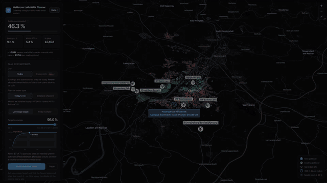
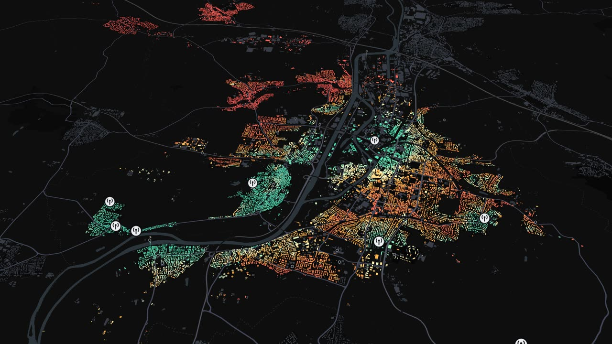
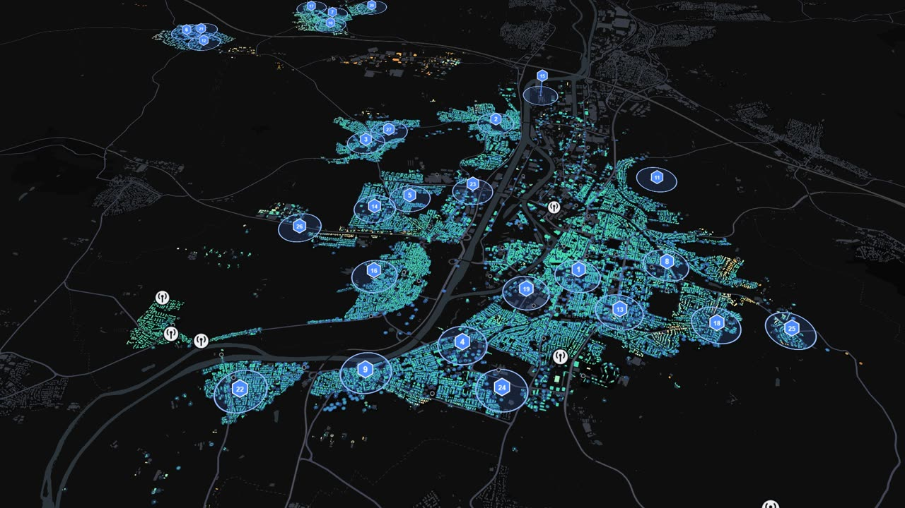
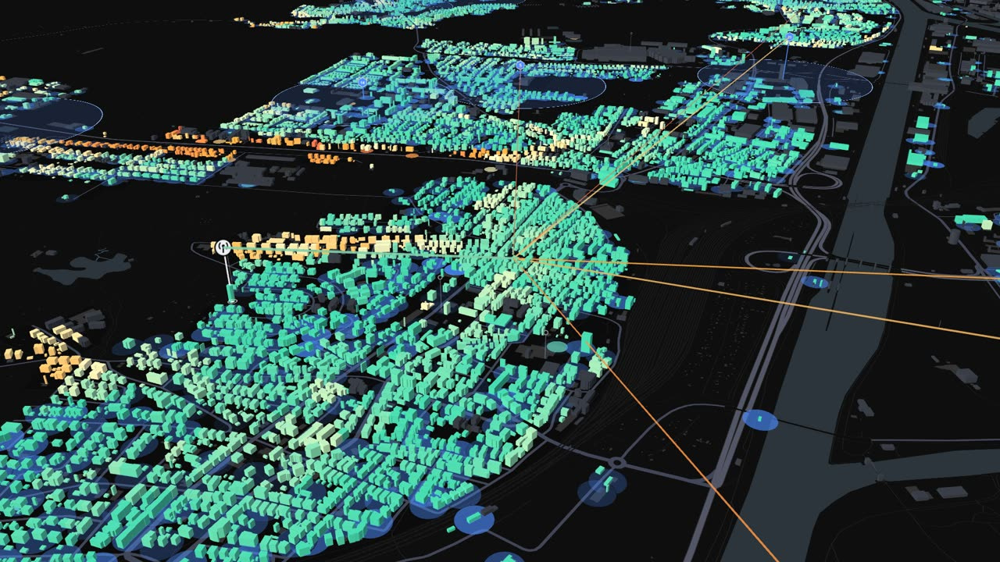
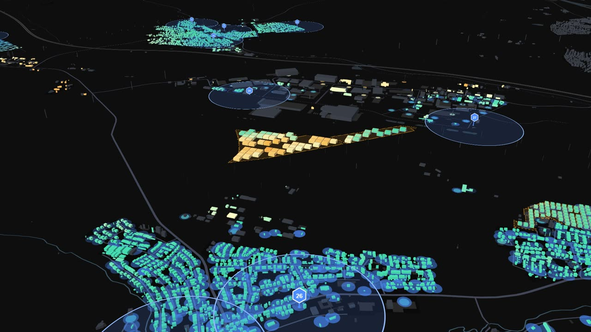
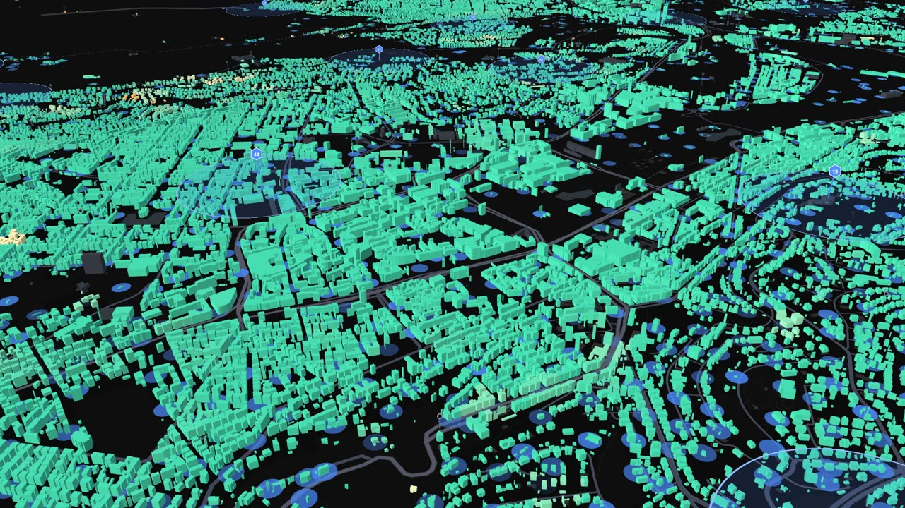
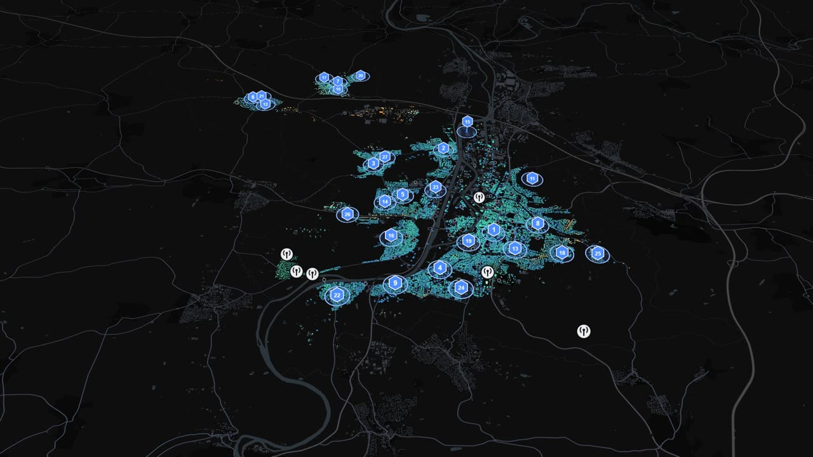
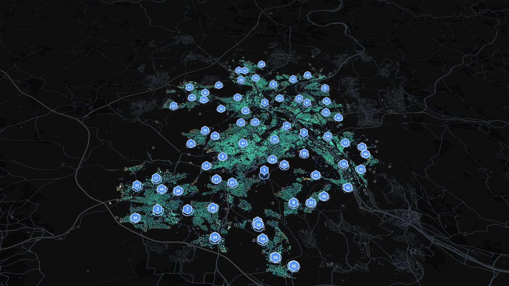
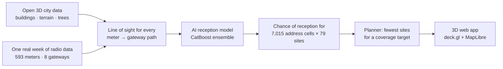

<div align="center">

# 📡 LoRaWAN Gateway Planner

### Fewer antennas. Every meter heard.

**Where should a city put the antennas that read its water meters by radio?**<br>
A 3D digital twin of Heilbronn that learns from real radio data and finds the fewest gateway sites that still hear (almost) every meter.

[](https://lorawan-gateway-planner.netlify.app/)


**Team Odyssey** · Aditya · Ayesha · Harsha · Kush

</div>

---

## 🎬 See it in action

<div align="center">

<a href="docs/media/demo.mp4"></a>

<sub>Preview at 4× speed. ▶ <a href="docs/media/demo.mp4"><b>Watch the full 68-second demo video</b></a> · 🌐 <a href="https://lorawan-gateway-planner.netlify.app/"><b>Try the live planner</b></a></sub>

</div>

| Time | What you see |
|---|---|
| 0:00 | Heilbronn today: **red** = water meters that no antenna can hear |
| 0:06 | Switching on all 71 approved sites: it works, but that is a lot of antennas |
| 0:10 | The planner picks **only the 27 sites that matter**: the city turns green |
| 0:21 | **Backup**: one home is heard by several gateways; one gateway fails and the others still catch it |
| 0:31 | **Future city**: new districts from the official building plans rise, and the plan grows with the city |
| 0:49 | **Stuttgart**: planned from open data only, with no data from the operator |

---

## 💡 The challenge in one picture

```
  💧 Water meter          📡 Antenna on a roof          🏢 HNVG
  sends its reading  ──▶  (a "gateway") catches   ──▶  gets the reading.
  by radio                the signal                    Nobody has to knock on the door.
```

**The problem:** buildings and hills block the radio signal. With today's 8 gateways, about half of Heilbronn's
homes are not heard, and their meters are still read by hand.

**The task:** the water utility HNVG has approved **71 places** for new gateways. Which of them should be built,
so that as few antennas as possible still hear almost every meter?

## 🎯 The answer

<table>
<tr>
<td width="50%"><br><b>Today</b>: red = not heard, green = heard</td>
<td width="50%"><br><b>With 27 of the 71 sites</b>: 98 % of meters heard</td>
</tr>
</table>

<div align="center">

| | Heilbronn today | **With our plan** | All 71 sites |
|:--|:--:|:--:|:--:|
| New gateways | 0 | **27** | 71 |
| Water meters heard (model) | ≈ 46 % | **98 %** | 99.2 % |

</div>

**Not more antennas. The right ones.** Less than 40 % of the approved sites reach 98 % coverage. The planner also
gives the **build order**, so every new gateway adds as much as possible.

| Coverage target | 80 % | 90 % | 95 % | **98 %** | 99 % |
|---|:-:|:-:|:-:|:-:|:-:|
| Sites needed | 6 | 11 | 17 | **27** | 45 |

---

## ⭐ What makes it unique

<table>
<tr>
<td width="33%" valign="top"><br>
<h3>🛡️ Backup for every gateway</h3>
Most homes are heard by two or more gateways. If one goes down, another still catches the reading. The planner can
plan for backup on purpose and simulate the failure of any gateway.</td>
<td width="33%" valign="top"><br>
<h3>🏗️ Future proof</h3>
We add the new buildings from the government's official building plans (XPlanung). For 98 %, Heilbronn needs
27 sites today and 32 once the planned districts are built, and we show that today's plan would drop to 97.4 %.</td>
<td width="33%" valign="top"><br>
<h3>🌍 Works in any city</h3>
Tested on Stuttgart (96,006 addresses, 258,832 buildings) with open data only. For any other city, drop in its
open data and run one command. The planner proposes rooftops by itself.</td>
</tr>
</table>

### 🗺️ From Heilbronn to every city

<table>
<tr>
<td width="50%"><br><b>Heilbronn</b>: 27 gateways, planned with HNVG's real radio data</td>
<td width="50%"><br><b>Stuttgart</b>: 67 gateways for 98 % (46 for 95 %), predicted by our model from open data</td>
</tr>
</table>

And not only water: heat and gas meters, smart parking, air-quality sensors and waste bins all talk by radio and need
the same answer: **where should the city listen?**

---

## ⚙️ How it works



1. **See the city in 3D.** 83,000 buildings, terrain, forest and tree canopy from official open data (LGL Baden-Württemberg), sampled every 5 m along every radio path.
2. **Learn from real signals.** The model learns from HNVG's own network which signals really arrive, including from meters deep in basements. It is chosen by honest *leave-one-gateway-out* validation, so it is tested on gateways it has never seen.
3. **Find the few places that hear everyone.** A greedy optimiser with pruning and 2-for-1 swaps finds the fewest approved sites that reach the coverage target, and the order to build them.

<details>
<summary><b>📊 Model validation (click to open)</b></summary>

<br>

13 learners compared on the same splits. The selection criterion is **leave-one-gateway-out log-loss**, because the
planner uses the prediction as a probability.

| Model | New area AUC | **New gateway AUC** | **New gateway log-loss** | Brier |
|---|---|---|---|---|
| Physics baseline (distance + height) | 0.944 | 0.937 | 0.212 | 0.061 |
| Neural network + line of sight | 0.962 | 0.931 | 0.241 | 0.064 |
| Gradient boosting (sklearn) + line of sight | 0.971 | 0.950 | 0.209 | 0.053 |
| LightGBM / XGBoost + line of sight | 0.972 | 0.958 | 0.189 | 0.051 |
| **CatBoost + line of sight** (monotonic constraints) | **0.974** | **0.961** | **0.174** | **0.049** |

* Signal-strength (RSSI) error is 3.5 dB, against 4.8 dB for the textbook log-distance model.
* The final model is a 7-model bootstrap ensemble, which gives a probability **and** an uncertainty for every link.
* Links whose path leaves the 3D data (≈ 12 %) use a distance + antenna-height model, because tree models handle missing obstruction data arbitrarily.
* The meter maker (read from the meter number) is a model input. The planner can plan for today's mix or for the weakest meter type.

</details>

<details>
<summary><b>🧩 Features of the app (click to open)</b></summary>

<br>

* A 3D city coloured by chance of reception, backup (≥ 2 gateways), expected signal strength or model certainty
* **Coverage target** slider with a live "coverage vs number of gateways" curve, and **Find minimum sites**, which returns the fewest sites with their build order
* **Fixed number** mode: best 1–10 sites for max coverage, HNVG's 300 m rule, confident-only, or with backup
* Click any gateway to switch it off: a failure simulation
* **City: Today | Future city** with a future-proof check of every plan
* A **Data & evidence** page: every number as a sortable table with CSV download
* A methodology drawer: insights, validation, what drives reception, and limits
* Shareable links, e.g. `/#t=98&city=future`

</details>

---

## 🚀 Run it yourself

> **Just want to look?** Open the **[live demo](https://lorawan-gateway-planner.netlify.app/)**. Nothing to install.

This repository contains the **code only**. The raw data and the generated app data are not included: the 3D
open data is about 12 GB, and HNVG's meter and radio data may not be published.

```bash
# 1. Install uv (it installs the right Python by itself): https://docs.astral.sh/uv/
uv sync

# 2. Put the downloads into data/raw (zip files are fine, nothing needs extracting)
uv run hnplan discover      # shows which files are found and used

# 3. Build everything: select data → features → train → predict → export (≈ 2–5 min)
uv run hnplan all

# 4. Open the planner
uv run hnplan serve         # http://localhost:8000
```

On Windows you can double-click **`start-planner.bat`** instead. More details and troubleshooting: **[SETUP.md](SETUP.md)**.

### Another city

```bash
uv run hnplan city stuttgart all                  # open data in cities/stuttgart/raw
uv run hnplan city stuttgart serve --port 8001
```

How to add a city: **[cities/README.md](cities/README.md)**.

### Useful commands

| Command | Does |
|---|---|
| `uv run hnplan optimize --target 98` | fewest approved sites for 98 % |
| `uv run hnplan optimize --target 98 --future` | the same for the future city |
| `uv run hnplan optimize -k 3 --objective redundancy` | best 3 sites with backup + failure analysis |
| `uv run --group bench hnplan benchmark` | compare the 13 learners |
| `uv run pytest -q` | tests |

### Data used

| Data | Source | Used for |
|---|---|---|
| Radio receptions, meter + gateway metadata, 71 candidate sites | HNVG (challenge data, **not included**) | training labels, planning targets |
| LoD1/LoD2 3D buildings, DOM1 surface, DGM1 terrain, DOP20 orthophotos, ALKIS, Basis-DLM, house coordinates | [LGL Open GeoData](https://www.lgl-bw.de/Produkte/Open-Data/) | line of sight, heights, trees, addresses |
| XPlanung land-use and regional plans | [Geoportal Raumordnung BW](https://www.geoportal-raumordnung-bw.de/) | future city |
| Weather (optional) | [Open-Meteo](https://open-meteo.com/) | weather vs reception |

---

## 🧱 Tech stack

**Python** (pandas, GeoPandas, rasterio, scikit-learn, CatBoost) · **FastAPI** · **deck.gl 9 + MapLibre** (no build
step, plain JavaScript) · **uv** for packaging · optional **Docker**.

```
config.yaml        all paths, dataset patterns, radio + model + optimiser parameters
src/hnplan/        data selector · 3D rasters · line-of-sight features · model · optimiser · future city · other cities · API · CLI
web/               the 3D planner (index.html, app.js, style.css) + Data & evidence page
cities/            any other city (template + Stuttgart config)
scripts/           demo video and pitch image recorders, ablation study
tests/             selector, geocoding, optimiser, site heights
docs/media/        demo video and images for this README
```

## ⚠️ Assumptions and limits

* One measured week. Most meters are in the west of the city, so predictions for the east and north are less certain; the app shows this.
* Real antenna mounting points are unknown. Every gateway is assumed on the highest nearby roof (+ 2 m mast), else on a tall structure or a 10 m mast, and never on a tree.
* "Coverage" means coverage for a meter deep indoors, in a basement. Street-level sensors will do better.
* Building plans say what *may* be built, not when. New buildings use a worst-case height.

---

<div align="center">

Built in Heilbronn for the **Future City Hackathon 2026** by **Team Odyssey**<br>
Aditya · Ayesha · Harsha · Kush

<sub>Geodata © LGL Baden-Württemberg (Datenlizenz Deutschland – Namensnennung 2.0). Radio data © HNVG, not included in this repository.</sub>

</div>
